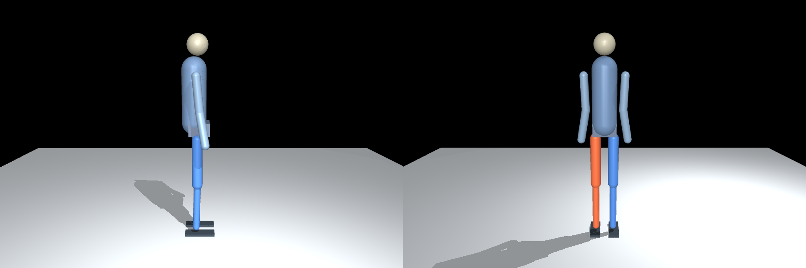

# 三维人体关节净力矩与接触力评估

本项目基于简化的 MuJoCo 人体刚体模型，面向 Xsens 运动数据和实验测力数据的三维动力学分析。
目标输出是左右髋 pitch/roll/yaw、膝 pitch、踝 pitch/roll 的关节净力矩，以及足部接触力和力矩。

当前已完成简化人体模型，以及**新实验者 Xsens 的关节拟合与骨盆辅助力矩追踪原型**。
当前数据仅使用 `data/y13_MVN_3_8_01.mvn` / `.xlsx`，受试者体重 **62.5 kg**、身高 **1.72 m**。
旧 Xsens、H5 和力台数据暂停使用；它们不属于这位新实验者。

逆动力学诊断流程已验证第 25–35 秒片段的 10 秒有辅助物理追踪，其无辅助控制仍会失稳。
新增 RL 基线已在同一片段完成 **10 秒零骨盆辅助、无中途重置** 的连续追踪，
关节误差 95 分位约 12.7°，根位置误差 95 分位约 0.90 m，尚需改善追踪精度并验证其他片段。
控制力矩、接触力和骨盆辅助均单独输出，不能把它们当作经实验验证的人体力矩。
完整流程、假设和结果说明见 [新 Xsens 开发说明](docs/y13_xsens_walk.md)。

另已提供 **mjlab 人体动作追踪基线**：基于同一人体和 Xsens 参考，使用 PPO 学习关节目标修正，
训练和评估均不施加骨盆辅助。使用项目内 `.venv-mjlab` 环境，入口为
`python tools/mjlab_human.py prepare/check/smoke/train/evaluate`（选择一个子命令）。
安装、训练、连续评估和力矩输出边界见 [RL 基线说明](docs/mjlab_human_tracking.md)。
本次训练 checkpoint、动画和定量结果见 [RL 验证结果](docs/mjlab_human_results.md)。

```bash
conda activate humanoid_sim
MPLBACKEND=Agg MPLCONFIGDIR=/tmp/imu-toque-mpl python tools/run_xsens_pipeline.py
python tools/view_human_motion.py --motion outputs/y13/walk_assisted.npz --duration 10
```

## 当前模型

采用 MS-Human Locomotion 的固定版本，派生为 10 个活动刚体、21 个速度自由度：
浮动基座 6、左右下肢 12、躯干 3；`nq=22`，`nv=21`，`nu=15`。
模型具有完整三维惯性参数，提供直接关节力矩接口，并保留上游来源、许可证和重建校验和。

膝关节简化为固定轴，脚趾和髌骨固定，上身内部姿态固定。踝关节保留上游斜向解剖转轴，
pitch/roll 是关节坐标别名。基础模板质量约 60.22 kg；新实验者的适配模型单独生成到 `outputs/y13/human.xml`，质量为 62.5 kg、几何身高为 1.72 m，惯性仍采用模板缩放近似。
详细定义和简化边界见 [模型说明](model/ms_human_locomotion/README.md)。



## 目录

```text
model/ms_human_locomotion/
  human.xml                 独立加载的简化人体模型
  derivation.json           身体合并、关节轴和惯性来源
  inspection.json           维度、质量与静态检查结果
  preview.png               正面和侧面预览
  source/                   固定提交的上游来源、许可证和必需资源
  README.md                 模型定义、构建和验证说明
data/
  y13_MVN_3_8_01.xlsx        当前实验者的 Xsens 导出结果
  y13_MVN_3_8_01.mvn         原生工程，保留供 Xsens 软件回查
  其余旧实验文件             暂不参与当前流程
  README.md                 数据字段、shape 与待标定事项
config/y13_trial.json        新实验者与本次仿真的显式配置
docs/y13_xsens_walk.md       当前流程、边界和复现方法
tools/
  build_ms_human.py          离线重建人体模型
  inspect_human_model.py     模型检查、静态查看与渲染
  prepare_xsens_model.py     根据新数据和用户参数生成试验模型
  fit_xsens_human.py         七个骨段 SO(3) 姿态拟合和残差
  simulate_xsens_walk.py     力矩驱动物理仿真与骨盆辅助记录
  compute_joint_torques.py   根据仿真外力重建关节净力矩
  plot_xsens_results.py      CSV 和诊断图
  view_human_motion.py       拟合/物理状态重放和动画导出
  run_xsens_pipeline.py      一键执行当前流程
  mjlab_human.py             RL 参考转换、验收、PPO 训练和连续评估
  plot_mjlab_tracking.py     RL 轨迹的 CSV、关节角与受力诊断图
  preview_xsens.py           Xsens 导出结果预览
  preview_force_plates.py    原始力台数据预览
tests/
  test_human_model.py        人体模型力学与重建验收
outputs/                    本地生成结果（Git 忽略）
```

## 运行

已在 Python 3.12、MuJoCo 3.9.0 验证；`requirements.txt` 记录此次验证的直接依赖版本。
已有 `humanoid_sim` 环境可直接使用；新环境安装后执行以下命令：

```bash
python -m pip install -r requirements.txt
python tools/inspect_human_model.py
python -m unittest discover -s tests -v
```

桌面查看静态模型：

```bash
python tools/inspect_human_model.py --viewer
```

从仓库内固定来源离线重建，不需要下载完整肌肉模型：

```bash
python tools/build_ms_human.py
```

生成本地预览；无头模型渲染需要可用的 EGL 后端：

```bash
MUJOCO_GL=egl python tools/inspect_human_model.py --preview outputs/human_preview.png
MPLBACKEND=Agg python tools/preview_xsens.py --frame 0 --no-show
```

检查 hooks 使用 `.pre-commit-config.yaml`。上游 `source/` 保留原始字节，排除自动格式改写，
其完整性由模型测试中的 SHA-256 校验保证。

## 当前开发顺序

1. 核对新记录的站姿标定、跑台速度、人体尺寸及接触几何。
2. 验证关节角拟合及其残差，改善接触和加速度参考，逐步减少骨盆辅助。
3. 完成零骨盆辅助的多步动态平衡测试，检查力矩、摩擦、CoP 与数值残差。
4. 如获得新实验者同次实验的同步测力数据，再验证人体力矩和接触力。

当前没有新实验的测力真值；旧 `fp_raw.csv` 不参与本流程。原始 Xsens 文件是处理后的导出结果，
不是完整的原始加速度计/陀螺仪流。数据边界见 [数据说明](data/README.md)。

旧 SZAR 机器人、机器人运动重定向和 WBC 控制实验已从本分支工作树移除。
需要追溯时查看清理前提交 `1936b40`；当前开发只围绕上述人体动力学分析流程。
